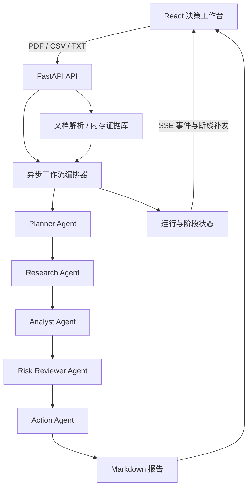

# SentinelAI 2.0 — Intelligent Operations Cockpit

企业供应链智能分析与风险决策平台的可运行 MVP，在原有 SentinelAI 上升级。Python FastAPI + AutoGen **0.7.5** + React。保留 PDF/CSV/TXT 上传、五阶段链路、Demo 数据、报告下载和移动端。

本轮新增统一模型配置、JSON 契约、证据引用与数值校验、预算/有限重试、SSE 重连补发、人工审批及七个真实页面：总览、工作流、证据中心、决策报告、待审批、运行历史、配置。

当前状态：**FINAL RELEASE VERIFIED**（2026-10-12）。DeepSeek 连接测试、五阶段 Live 和最终报告生成已通过；Reviewer 要求补充证据，行动仍待人工审批。最新结果见[验收资料入口](docs/evaluation/README.md)，技术流程完成不代表业务建议已获批准。

## 五阶段工作流

```text
上传证据 → Planner → Research → Analyst → Risk Reviewer → Action → Markdown 报告
```

每一步只有在上一阶段完成后才开始，前序输出与原始资料会传给下一位 Agent。单个阶段失败会停止链路并在界面显示错误，不会输出不完整报告。



编排由 FastAPI 中的固定顺序异步任务控制；AI 模式每阶段创建独立 AutoGen `AssistantAgent`，共享模型客户端并显式传递前序产出。Research 的证据范围限于上传文件，Action 输出行动建议，不会自动执行外部操作。

所有 Agent 输出经过 Pydantic JSON 契约校验。文件事实、Python 计算、模型假设与外部待验证信息分别记录。Reviewer 必须给明确判断，错误引用或数值冲突不能被 pass 覆盖；高影响行动进入服务端审批。审批只代表授权，不执行采购、合同或付款。

| 模式 | 说明 |
| --- | --- |
| 规则演示（默认） | 无需密钥；使用 CSV 的实际数值计算固定指标与演示规则，逐步展示五个 Agent 的结果。**不执行 AI 推理**。非标准 CSV/TXT/PDF 使用资料摘要与保守的通用模板。 |
| Live / AutoGen AI | 配置自己的 `OPENAI_API_KEY` 后，使用 AutoGen AgentChat **0.7.5** 的五个 `AssistantAgent` 发起真实在线 Chat Completions 请求。远端推理可能因超时或结构化输出不符合契约而失败；不会自动回退。 |
| Replay | 使用 AutoGen 回放客户端和结构合法的固定响应验证执行链。**不代表在线模型调用**。 |

所有上传文件、事件和审批保留在后端进程内存中，重启清空。审批是后端颁发的 1 小时本机 Reviewer 会话（HttpOnly/SameSite Cookie + Origin/角色/状态校验），不是企业 SSO/多租户权限。保持绑定 127.0.0.1，勿用于生产。没有外部检索或外部操作工具。**本项目按代码仓库交付，评委在本机运行；没有独立在线演示链接。**

## 快速启动

需要 Python **3.11+**（本轮使用 3.12）、Node.js **20+**。从代码仓库根目录在两个终端分别执行；先确认 `python3 --version` 指向 3.11+，否则把下方 `python3` 换成已安装的 `python3.12`：

```bash
python3 -m venv .venv
source .venv/bin/activate
pip install -r backend/requirements.txt
uvicorn app.main:app --app-dir backend --host 127.0.0.1 --port 8000
```

```bash
cd frontend
npm ci
npm run dev
```

打开 [http://127.0.0.1:5173](http://127.0.0.1:5173)。初始页面预置 `demo/suppliers.csv`、`demo/brief.txt` 和决策问题。**不需要任何密钥**：保持 Demo（规则演示）或选择 Replay（离线模型回放），点击「启动多 Agent 分析」，完成后在「决策报告」下载 `.md` 文件。不要把 Replay 的返回当作真实在线推理。

要启用 DeepSeek Live，评委自行在本地提供密钥；不要将真实密钥提交到仓库。现有后端支持环境变量 `OPENAI_API_KEY`、`OPENAI_MODEL`、`OPENAI_BASE_URL`（变量名沿用 OpenAI-compatible 接口，并不要求使用 OpenAI 服务）。示例配置在 [backend/.env.example](backend/.env.example)：

评委可直接点击工作台首页的「模型配置」，填写自己的 Base URL、API Key 和模型名，主动点击「测试连接」；确认成功后返回总览，选择资料和 Live，再启动分析。密码框不回填，配置仅存后端当前进程内存，保存后立即生效，刷新可继续使用、服务重启后恢复环境配置；不会修改环境变量或写入 Git 文件。保存不会调用模型，「测试连接」会显式消耗一次最小请求额度。首次未配置时首页提示，Live 启动会跳转设置，Demo 仍可直接运行。详见[模型配置说明](docs/MODEL_SETUP.md)。

```bash
cp backend/.env.example backend/.env
# 仅在本地编辑 backend/.env：将 OPENAI_API_KEY 的占位符换为自己的密钥。
# 可保持示例模型 deepseek-chat；模型须由实际服务支持。
```

也可以在启动后端的同一终端设置环境变量，不必创建 `.env`。启动时配置优先级：进程环境变量、根目录 `.env`、`backend/.env`，不会覆盖已有变量；工作台保存可在当前进程内覆盖模型配置。示例 Base URL 为 `https://api.deepseek.com/v1`，客户端实际请求 Chat Completions；不要把仅支持 Responses 的服务地址直接当作 Chat Completions 使用。修改环境变量或 `.env` 后需重启后端再测试连接；工作台保存无需重启。重启会清空后端内存中的上传和任务，请先保留所需资料。

配置页「测试连接」是显式在线入口；启动、健康检查、构建与离线测试不调用模型。缺少有效凭据时，启动 Live 会提示并跳转模型配置页，后端也拒绝未配置的 Live 请求；真实调用失败则保持 Live 并标记 failed，绝不回退为 Demo。连接测试成功仅确认正常模型响应，五阶段结构化输出仍需任务验证。

本地 token 限制默认关闭：`MODEL_MAX_OUTPUT_TOKENS=0` 不发送请求输出上限，`TASK_TOKEN_BUDGET=0` 关闭本地任务 token 预算；模型服务自身的上限仍然存在。可通过正整数恢复有限值。已有环境或 `.env` 的正整数配置仍优先，不会被程序覆盖；超时和输出校验继续有效。

最终验收使用 `deepseek-flash` 完成连接测试及一次完整 Live：五阶段耗时共 242.61 秒，Reviewer 首次 JSON 校验失败后按既有策略重试一次成功，无 Demo/Replay fallback，最终报告已生成。详情见[最终验收报告的 Final Attempt 章节](docs/evaluation/FINAL_RELEASE_VERIFICATION.md#2026-10-12-final-attempt独立实例asiashanghai)。[只读桥接脚本](scripts/deepseek.sh) 仅为本机可选便利工具，评委无需安装 CC Switch；推荐使用自己的兼容模型配置和密钥。单次验收成功不保证任意服务配置都能复现。

## 演示路线

1. 总览查看示例供应商指标与风险标记，强调阈值仅为演示规则。
2. 在右侧选择示例资料或上传 PDF/CSV/TXT，输入自己的决策问题。
3. 启动分析，切换五个 Agent 查看状态和阶段输出。
4. 在报告页浏览完整 Markdown 内容并下载。
5. 在证据中心查看原始记录定位、Python 指标与引用，待审批页填写意见并批准/驳回/要求补资料。
6. 工作流事件时间线记录真实阶段及工具调用；网络重连补发事件，失败重跑保留原任务并建立新记录。

## API

交互文档：[http://127.0.0.1:8000/docs](http://127.0.0.1:8000/docs)。主要端点：`GET /api/bootstrap`、`POST /api/files`、`POST /api/runs`、`GET /api/runs/{id}`、`GET /api/runs/{id}/report`。文件最大 10 MB，每次至多 12 个，PDF 仅支持可提取文本的文档（无 OCR）；CSV 数值分析识别示例表头，单次最多解析前 2000 行。接口仅供本地 Demo 使用。

新增 events、retry、model/config、model/test、session、approvals。旧 API 核心字段 `agents[].output` 和 `report` 保留，新增结构化字段；旧客户端必须接受 `waiting_approval` 状态，表示分析结束而行动仍需审查。并发上限 3；POST runs 支持 Idempotency-Key。

证据索引限制 PDF 80 页、CSV 100 条原始记录、TXT 100 行；多个 CSV 使用首个兼容表，未自动合并不同口径。单期快照没有趋势图；引用覆盖不是语义核验或校准概率。完整历史持久化、跨重启恢复、高级审批权限、更多协议和复杂趋势分析仍未实现。

测试：

```bash
PYTHONPATH=backend .venv/bin/python -m unittest discover -s backend/tests -v
cd frontend && npm run build
```

浏览器端到端检查（先启动两端服务，首次执行 `npx playwright install chromium`）：

```bash
cd frontend && npm run smoke
```

最新发布验收见[验收资料入口](docs/evaluation/README.md)；[TEST_RESULTS.md](docs/TEST_RESULTS.md) 保留早期测试记录。交付文档：[实施审计](docs/IMPLEMENTATION_AUDIT.md)、[2.0 架构](docs/ARCHITECTURE_2.0.md)、[模型配置](docs/MODEL_SETUP.md)、[3 分钟演示脚本](docs/DEMO_SCRIPT.md)。
