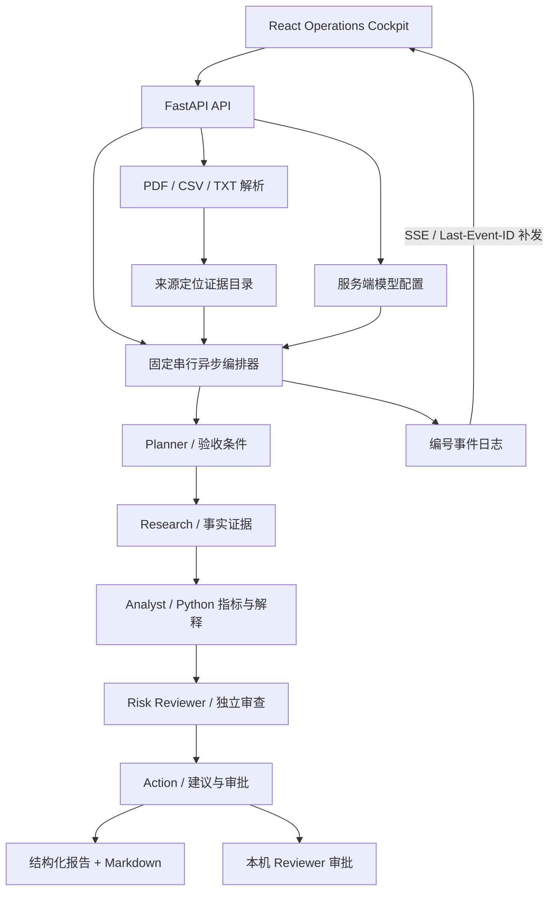

# SentinelAI 2.0 架构与契约

## 分层与执行路径

复用 FastAPI、AutoGen 0.7.5、React 和原有依赖，没有新增模型协议适配器、路由库或图表依赖。图表使用数据驱动 SVG。没有外部检索、采购执行或合同工具。

## Agent 契约

`contracts.py:StageOutput` 以 Pydantic 严格验证 JSON（未知字段拒绝、非有限数值拒绝）。所有 Agent 输出 `summary`、`claims`、`risks`、`actions`、`review_decision`、`review_findings`、`unresolved`；Planner 另需 `acceptance_conditions`，Risk 必须给真实审查判断，Action 至少一项建议。

事实区分 `fact`、`computed`、`hypothesis`、`external_unverified`。计算结论的 `metric_values` 和证据 `M-*` 必须匹配 Python 数值。错误 ID、缺失证据和数值冲突不能被 Reviewer 的 `pass` 覆盖；覆写后的审查结果传入 Action。自由文字语义仍需模型 Reviewer/人工核验，ID 存在不代表语义正确。

证据记录包含 `evidence_id/source_file/source_location/supporting_excerpt/related_claim/verification_status`，另含类型、供应商、风险类别与 demo_data。文件原文保存页码、记录号或行号；模型假设保留独立待验证记录，不能伪装为文件引用。`verified` 只表示来源定位或 Python 计算可核验，不代表供应商业务事实外部核实。

置信度使用事实/计算结论的引用覆盖数量和明文定义，不输出校准概率。文件和工具范围限制写入报告；单期 CSV 不伪造趋势。

## 执行与模式

demo：固定规则 + Python 指标；短延迟仅用于展示，不是推理。
live：真实 `AssistantAgent` + OpenAI-compatible Chat Completions 客户端，结构化 JSON 输出，绝不静默回退。
replay：AutoGen `ReplayChatCompletionClient` + schema 合法的固定响应，用于离线回放，不是在线推理。

每次模型请求 asyncio 超时，SDK 重试为 0，由执行器统一控制 0–2 次重试。认证失败不重试；限流/5xx/连接/超时/结构异常有限重试。任务有全局 wall-clock 预算。默认不发送 max_tokens，也不拦截本地任务 token 预算；MODEL_MAX_OUTPUT_TOKENS/TASK_TOKEN_BUDGET=0 表示关闭，正整数可恢复有限值。服务方输出和上下文限制仍有效。按 UTF-8 byte count 估算输入预留，显式限制输出时再加输出预留；无输出限制时该估计不包含未知输出，不能作为严格费用上限。兼容服务缺失 observed token 用量时显示未提供。

任务并发上限 3；POST runs 支持 Idempotency-Key。失败保存已有事件和阶段结果，禁止完整报告。retry 创建新任务并保留 parent_run_id 与旧记录，不断点续跑模型消息。取消未提供 UI；服务停止会取消后台任务并标记中断（记录仍受内存生命周期限制）。

## 事件与终态

`event_id` 为任务内单调序号，包含 task_id/timestamp/stage/status/payload。事件：task.created/started、agent.started/progress/completed/failed、tool.started/completed、review.required、task.completed/failed。工具仅记录确实发生的证据索引/指标计算。

`GET /api/runs/{id}/events?after=N` 接受 Last-Event-ID，重连补发；前端按 ID 去重。浏览器断线不终止后端执行。`task.completed` 表示五阶段执行完成，任务状态可为 `waiting_approval`，不等于行动已批准。SSE 实时推送阶段事件，不推送隐藏思考或原始模型 token。

当前代码的 E-* `verified` 表示来源位置可定位，M-* `verified` 表示 Python 数值可复算；UI 显示“来源可定位”。这不是外部业务真实性背书。API 对任务查询、SSE 和 Markdown 输出执行已知密钥/Authorization 脱敏。

## API 迁移说明

原有上传、bootstrap、运行查询、Markdown 下载路径与核心字段保留，新增 structured_output/evidence/events/budget/model/approvals。旧客户端应接受新增 `waiting_approval` 状态；不再将其视为运行中。新增 model/config、model/test、session、approvals、events、retry。历史仍在内存。

审批请求需要后端颁发 HttpOnly/SameSite=Strict 的 1 小时本机 Reviewer 会话、受信任 Origin 和状态校验；证据不足禁止批准；重复批准 409。这个授权只适合绑定 127.0.0.1 的单人 MVP，不是企业身份/租户/SSO 系统。要求补资料后应上传并重新分析，不允许仅写一句意见绕过证据门禁。

## 保护边界与限制

上传资料被明确标为不可信 JSON 数据；系统指令禁止文档改变策略或发起外部调用。没有外部操作工具可被诱导调用。服务错误仅暴露分类信息；已知 API Key、Bearer/Authorization 及 sk-形式秘密脱敏。资料本身仍可能含企业敏感内容，MVP 仅供本机使用。

10 MB/12 文件上传，CSV 行列校验、空/二进制拒绝，批量上传先全部解析再提交。CSV 指标最多前 2000 行，证据原文最多 100 行/记录、PDF 80 页；无 OCR。多个 CSV 选择首个兼容表作为指标来源，不自动合并不同口径。不支持跨重启历史恢复、多 worker 共享、无限制文档语义覆盖、生产并发或多租户隔离。
